# Home SOC Lab Using Splunk

> **Work in progress:** This Home SOC Lab is being developed and documented in stages. Step 8.2 (successful Windows logon monitoring) is pending; additional results and screenshots will be added as work continues.

A hands-on Security Operations Center (SOC) home lab** built with an Ubuntu Splunk Enterprise server and a Windows 11 endpoint. This project demonstrates Windows Security Event Log collection, log forwarding, Splunk Processing Language (SPL) investigations, and dashboard-based monitoring.


## Lab architecture

```text
Windows 11 endpoint (Xamuel)
  └─ Windows Security Event Logs
       └─ Splunk Universal Forwarder 10.4.3
            └─ TCP 9997
                 └─ Ubuntu SOC server (Splunk Enterprise 10.4.1)
                      └─ Splunk Web (TCP 8000)
                           └─ Searches, investigations, dashboards
```

### Tools and environment

- Ubuntu Linux (SOC monitoring server)
- Windows 11 (monitored endpoint)
- Splunk Enterprise 10.4.1
- Splunk Universal Forwarder 10.4.3
- Windows Security Event Logs
- Splunk Processing Language (SPL)
- Windows PowerShell and Linux terminal
- TCP/IP networking

| Port | Purpose |
| --- | --- |
| TCP **9997** | Receives forwarded logs from the Windows endpoint |
| TCP **8000** | Splunk Web interface |

**Windows Security Event IDs investigated:** `4624` (successful logon) and `4625` (failed logon).

> **Privacy note:** IP addresses in this document are private LAN addresses from the lab. No passwords, authentication tokens, or other secrets are included. If reproducing the setup, substitute your own device names and IP addresses.

## 1. SOC Server Preparation

I used an Ubuntu system as the central Splunk Enterprise server. Before configuring log collection, I verified the hostname, network configuration, Splunk version, and service status. Splunk Enterprise was already installed before I began documenting the lab.

```bash
hostname
ip addr
/opt/splunk/bin/splunk version
/opt/splunk/bin/splunk status
```

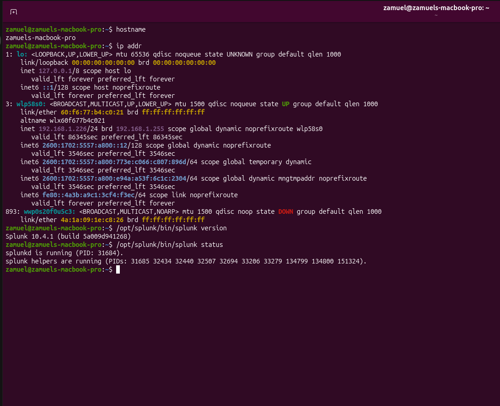

*Figure 1: Ubuntu SOC server hostname, network configuration, Splunk Enterprise version, and service status verification.*

| Ubuntu server information | Value |
| --- | --- |
| Hostname | `zamuels-macbook-pro` |
| Private IPv4 | `192.168.1.226` |
| Role | Splunk Enterprise / SOC server |

## 2. Network Connectivity Verification

Before configuring log forwarding, I verified that the Windows 11 endpoint and Ubuntu SOC server could communicate over the local network. From Windows PowerShell, I ran:

```powershell
ping 192.168.1.226
```

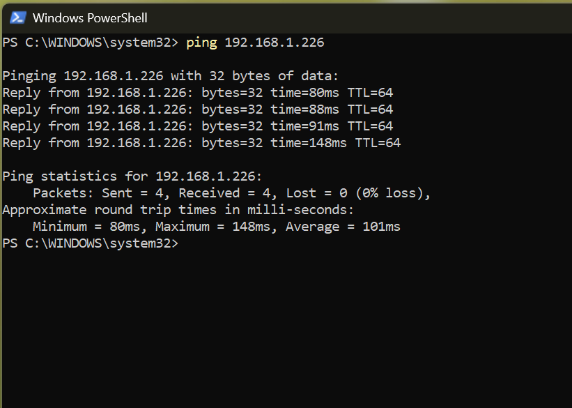

*Figure 2: Successful network connectivity test from the Windows 11 endpoint to the Ubuntu SOC server (`192.168.1.226`).*

## 3. Configure Splunk Enterprise to Receive Forwarded Data

Before the Windows endpoint could send logs, I configured Splunk Enterprise to listen for forwarded data.

In Splunk Web, I navigated to **Settings → Forwarding and Receiving → Configure Receiving**, enabled **TCP port 9997**, and saved the configuration.

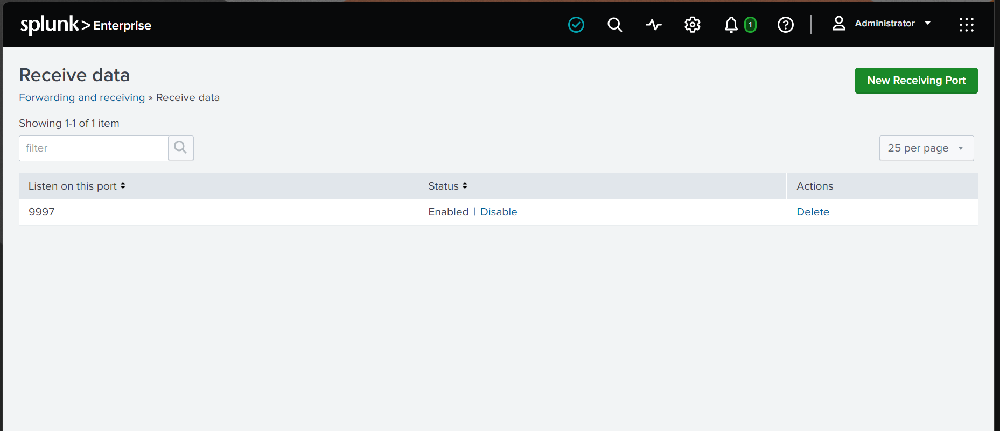

*Figure 3: Splunk Enterprise configured to receive forwarded data on TCP port 9997.*

## 4. Install and Configure Splunk Universal Forwarder on Windows 11

I downloaded the 64-bit Splunk Universal Forwarder installer for Windows 11 and selected **An on-premises Splunk Enterprise instance**, because the receiving server runs on Ubuntu within my local network.

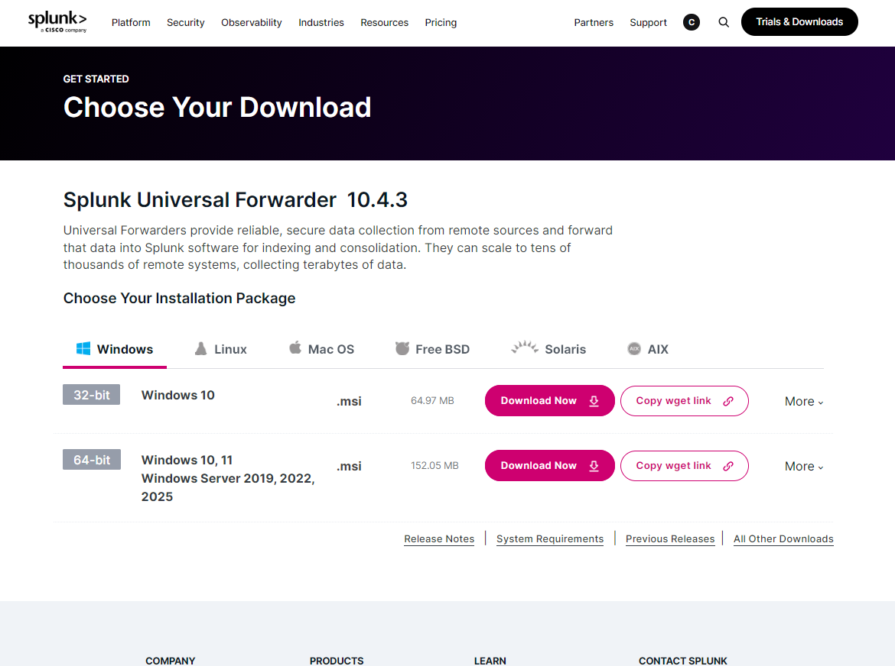

*Figure 4: Splunk Universal Forwarder 10.4.3 Windows installer download.*

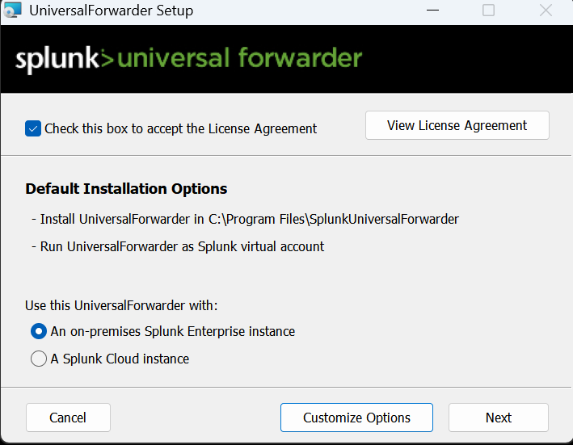

*Figure 5: Forwarder installation configured for an on-premises Splunk Enterprise instance.*

I configured administrator credentials for managing the Universal Forwarder. Credentials are intentionally omitted from the documentation.

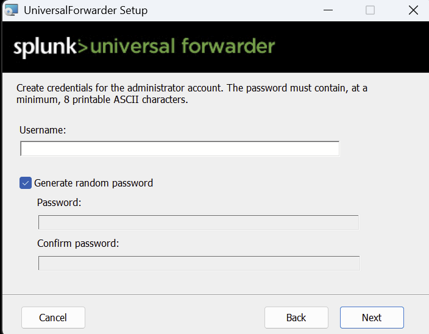

*Figure 6: Creating administrator credentials for Splunk Universal Forwarder.*

A deployment server was unnecessary for this single-endpoint lab, so I left those fields blank.

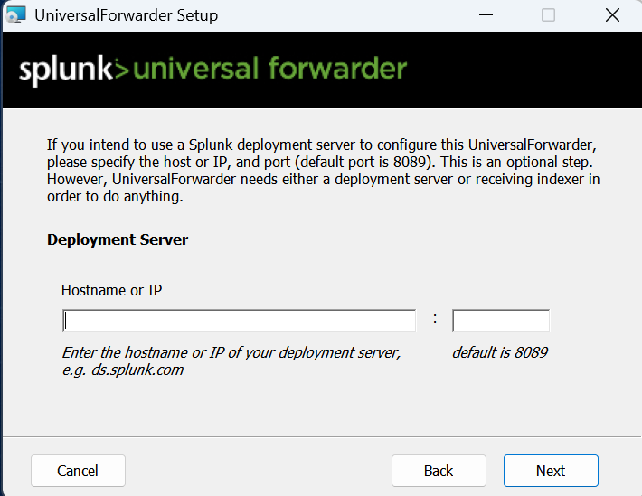

*Figure 7: Deployment server fields left blank for the single-endpoint home SOC lab.*

On the **Receiving Indexer** screen, I entered **`192.168.1.226`** as the Ubuntu server address and **`9997`** as the receiving port.

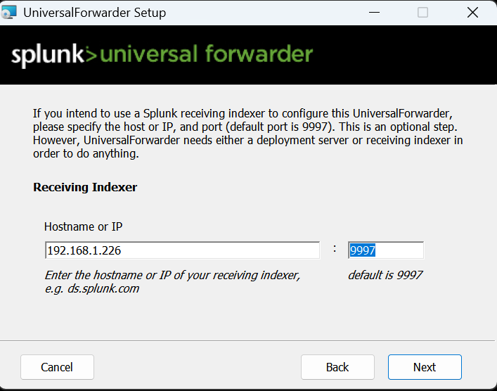

*Figure 8: Universal Forwarder configured to send data to the Ubuntu SOC server on TCP port 9997.*

## 5. Configure Windows Security Event Log Collection

After installing the forwarder, I verified its Windows service was running. In an elevated PowerShell window, I ran:

```powershell
Get-Service SplunkForwarder
```

I opened the forwarder configuration file using:

```powershell
notepad "C:\Program Files\SplunkUniversalForwarder\etc\system\local\inputs.conf"
```

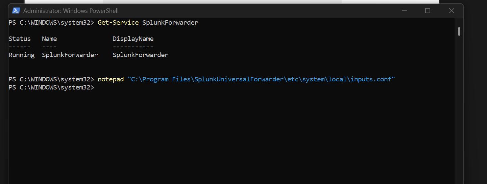

*Figure 9: PowerShell verification showing the Splunk Universal Forwarder service running.*

I enabled collection of the Windows Security Event Log in `inputs.conf`:

```ini
[WinEventLog://Security]
disabled = 0
```

The input stanza selects the Windows Security Event Log, while `disabled = 0` enables collection.

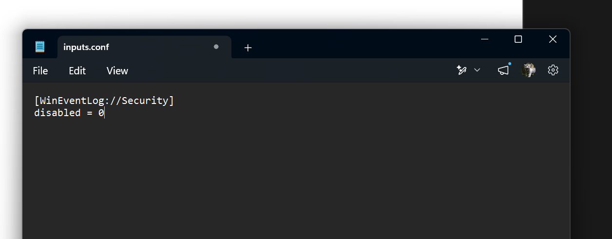

*Figure 10: Forwarder `inputs.conf` enabling collection of the Windows Security Event Log.*

After saving the configuration, I restarted the forwarder service:

```powershell
Restart-Service SplunkForwarder
```

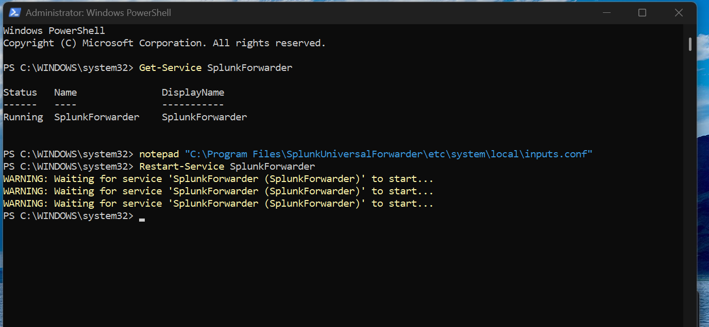

*Figure 11: Restarting the Universal Forwarder service to apply the `inputs.conf` configuration.*

## 6. Verify and Investigate Windows Security Events in Splunk

In **Search & Reporting** on the Ubuntu Splunk server, I searched for Windows Security Event ID `4625`. At the time of testing, the search returned **13 events**, confirming that failed-authentication logs from the Windows endpoint were searchable on the SOC server.

```spl
index=* EventCode=4625
```

Event ID `4625` represents a **failed Windows logon**.

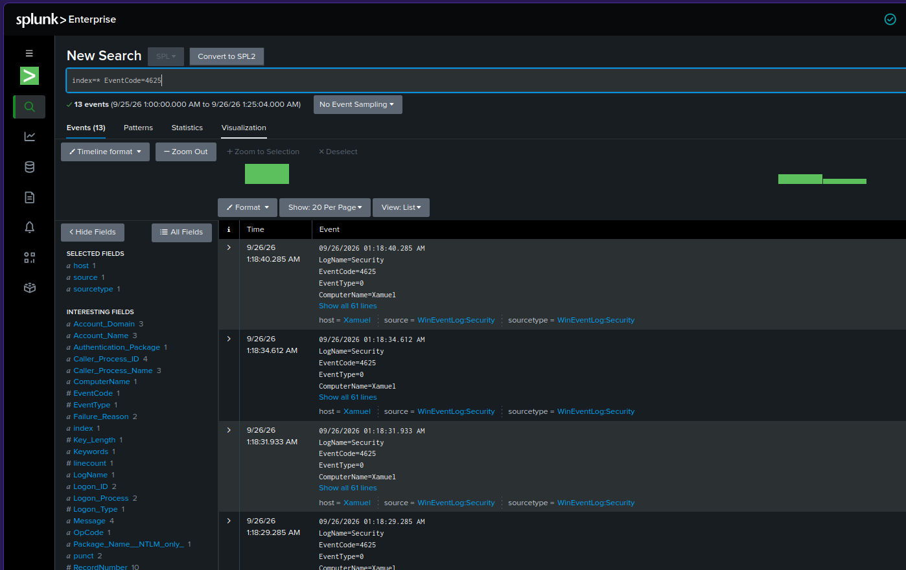

*Figure 12: Splunk Search & Reporting showing Windows Security Event ID 4625 received from the Windows 11 endpoint.*

## 7. Analyze Failed Logon Activity Using SPL

I used Splunk Processing Language (SPL) to group failed Windows logons by account:

```spl
index=* sourcetype="WinEventLog:Security" EventCode=4625
| stats count by Account_Name
| sort - count
```

To inspect individual events, I ran:

```spl
index=* sourcetype="WinEventLog:Security" EventCode=4625
| table _time host Account_Name TargetUserName Logon_Type Source_Network_Address Failure_Reason
| sort - _time
```

During the **24-hour** search period shown in the evidence, Splunk returned **3 failed-logon events**. Their details included `Logon_Type=2`, `Source_Network_Address=127.0.0.1`, and the failure reason **“An Error occurred during Logon.”** These observations identify failed authentication activity but do not establish an external attack or its root cause.

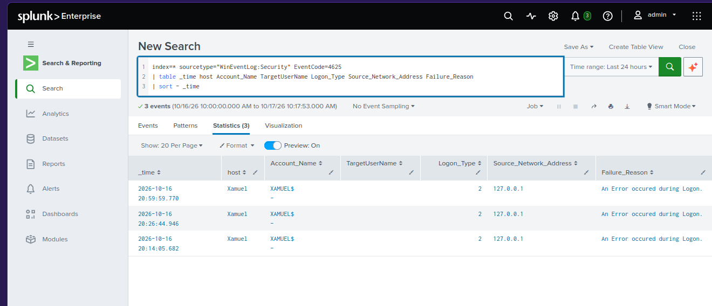

*Figure 13: Splunk Search & Reporting showing failed Windows logon events and their authentication details.*

## 8. Create a Security Monitoring Dashboard in Splunk

I created a **Classic Dashboard** named **Home SOC Security Monitoring** to display Windows authentication activity without having to retype searches.

### 8.1. Failed Windows Logons (Event ID 4625)

I selected **Dashboards → Create New Dashboard → Classic Dashboard**, then **Add Panel → New → Single Value**. I configured the panel with this SPL query and a **Last 24 hours** time range:

```spl
index=* sourcetype="WinEventLog:Security" EventCode=4625
| stats count
```

The panel showed **3 failed-logon events** at the time it was created. I added the panel and saved the dashboard.

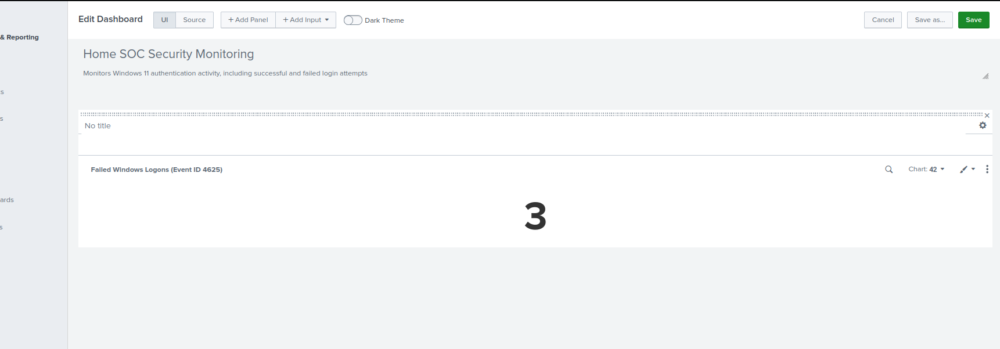

*Figure 14: Home SOC Security Monitoring dashboard editor showing a Single Value panel with three failed Windows logons (Event ID 4625).*

### 8.2. Successful Windows Logons (Event ID 4624) — In Progress

The next panel will count successful Windows logons using Event ID `4624`:

```spl
index=* sourcetype="WinEventLog:Security" EventCode=4624
| stats count
```

**Pending:** Confirm the result, add the Single Value panel, save the dashboard, and capture a final screenshot for **Figure 15**. No result count has been recorded yet.

## Next steps

- Finish the successful-logon dashboard panel and capture Figure 15.
- Add a visualization of authentication events over time.
- Perform a controlled failed-logon test and verify that Splunk records the events.
- Review and publish the final lab evidence on GitHub.

---

**Lab scope:** This project is a learning environment for collecting and investigating Windows authentication logs; detected failed logons do not, by themselves, demonstrate malicious activity.
